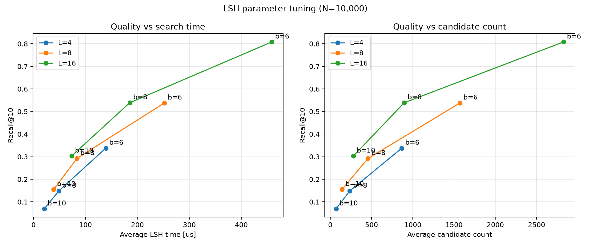
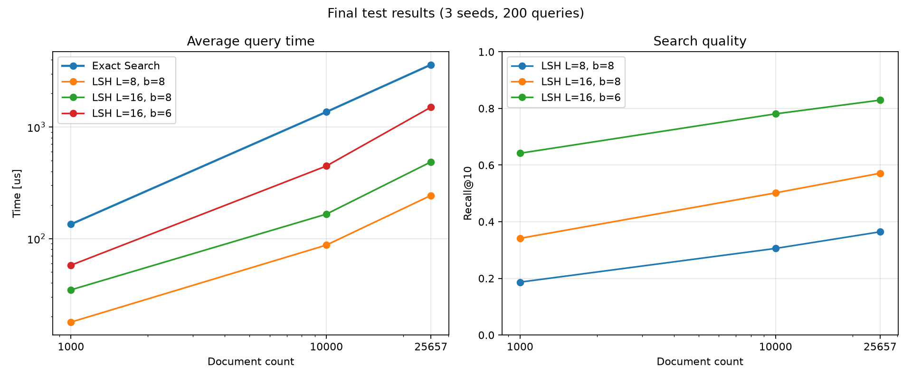

# Semantic Search with Random-Hyperplane LSH

A small semantic search engine built around my own C++23 implementation of random-hyperplane Locality-Sensitive Hashing. Python prepares normalized text embeddings and plots results; C++ builds the index, collects candidates, ranks them with cosine similarity, and provides an exact-search baseline. No ANN library is used.

## Method and data

The hash function is based on Moses Charikar's [*Similarity Estimation Techniques from Rounding Algorithms*](https://doi.org/10.1145/509907.509965) (STOC 2002). The sign of a projection onto a random hyperplane produces one bit. Each of `L` independent hash tables uses `b` bits; matching buckets are merged and ranked exactly with a top-k heap.

The dataset is [BEIR SciDocs](https://huggingface.co/datasets/BeIR/scidocs): 25,657 English documents, 100 tuning queries, and 200 separate test queries. Embeddings are produced by [`sentence-transformers/all-MiniLM-L6-v2`](https://huggingface.co/sentence-transformers/all-MiniLM-L6-v2), have 384 dimensions, and are normalized, so a dot product equals cosine similarity.

## Results

Parameter tuning shows the expected trade-off: more tables (`L`) and shorter signatures (`b`) improve recall but increase candidate count and latency.



Final results use three seeds and 200 test queries. Measurements were single-threaded, compiled with GCC 13.3 and `-O3`, on an Intel Core i7-12700KF.

| Method | Recall@10 | Candidates | Latency p50 | Latency p95 | Build time | Index payload* |
|---|---:|---:|---:|---:|---:|---:|
| Exact search | 1.000 | 25,657 (100%) | 3,601 us | 3,752 us | - | - |
| LSH `L=8, b=8` | 0.364 | 1,083 (4.2%) | 235 us | 348 us | 263 ms | 1.66 MiB |
| LSH `L=16, b=8` | 0.571 | 2,174 (8.5%) | 475 us | 665 us | 527 ms | 3.32 MiB |
| LSH `L=16, b=6` | 0.829 | 6,900 (26.9%) | 1,499 us | 1,888 us | 403 ms | 3.27 MiB |

The fastest configuration is about 15x faster than exact search at median latency, but reaches only 0.364 Recall@10. The higher-recall configuration reaches 0.829 at about 2.4x speedup.



Raw results: [tuning](benchmark/tuning_results.csv) and [final test](benchmark/test_results.csv).

\* Logical lower bound: hyperplane values and stored document IDs. It excludes `unordered_map` nodes, buckets, vector capacity, and allocator overhead. The shared embedding matrix is about 37.6 MiB and is not included.

## Build and run

```bash
python3 -m venv .venv
.venv/bin/pip install numpy sentence-transformers datasets matplotlib
.venv/bin/python scripts/prep_embeddings.py

cmake -S . -B build-release -DCMAKE_BUILD_TYPE=Release
cmake --build build-release
./build-release/LSH_algo
./build-release/LSH_benchmark
.venv/bin/python scripts/plot.py
```

Run assertions in a Debug build:

```bash
cmake -S . -B build -DCMAKE_BUILD_TYPE=Debug
cmake --build build --target LSH_tests
ctest --test-dir build --output-on-failure
```

## Limitations

- The index is static, in-memory, and single-threaded. It has no updates, persistence, multi-probe search, API, or GUI.
- Results cover one English dataset and one embedding model. Dataset and model revisions are not pinned.
- Recall@10 measures agreement with exact vector search, not semantic relevance judged by people.
- Timings are machine-specific and exclude embedding generation. Memory numbers are lower bounds, not process RSS.
